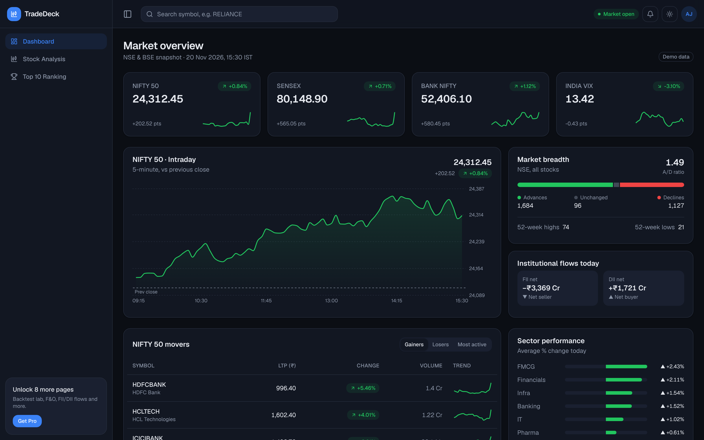

# TradeDeck: Next.js Dashboard for Indian Markets

A clean, fast stock market dashboard template built for **NSE/BSE**: ₹ formatting with
lakh/crore, NIFTY 50 stocks, FII/DII flows, TradingView candlestick charts and a
technical ranking screen. Built with **Next.js 16, React 19, Tailwind CSS v4,
shadcn/ui and TypeScript**. No backend needed: everything runs on editable mock data
until you plug in your own API.

> **Live demo:** `https://your-demo-url.vercel.app` · **Pro version (11 pages):** `https://your-gumroad-link`



---

## Contents

- [Features](#features)
- [Quick start](#quick-start)
- [Folder structure](#folder-structure)
- [Customisation](#customisation)
  - [Brand name and links](#1-brand-name-and-links)
  - [Colours and dark/light mode](#2-colours-and-darklight-mode)
  - [Mock data](#3-mock-data)
  - [Connecting a real API](#4-connecting-a-real-api)
  - [Adding a page](#5-adding-a-page)
  - [Ranking model](#6-ranking-model)
- [Deploy to Vercel](#deploy-to-vercel)
- [Lite vs Pro](#lite-vs-pro)
- [Licence and attribution](#licence-and-attribution)
- [FAQ](#faq)

---

## Features

**Pages (Lite)**

| Page | Route | What's on it |
|---|---|---|
| Market overview | `/` | NIFTY 50, SENSEX, BANK NIFTY and INDIA VIX cards, NIFTY intraday chart, market breadth, FII/DII flows, gainers/losers/most active, sector performance |
| Stock analysis | `/analysis?symbol=TCS` | TradingView candlestick chart with volume, SMA 20/50, EMA 200 and RSI 14, 1M–1Y ranges, key stats, technical summary, stock switcher |
| Top 10 ranking | `/rankings` | Composite technical score, top 3 cards, sortable and searchable table, sector filter |

**Built in**

- Dark and light mode (follows the system setting, dark by default)
- Fully responsive: collapsible sidebar on desktop, slide-in drawer on mobile
- Indian number formatting: `₹12,34,567.80`, `98.14 L`, `1.4 Cr`, `₹19.65 L Cr`
- One data-access file: swap mock data for a real API in one place
- shadcn/ui components and naming, so `npx shadcn add <component>` works
- Colour-blind friendly: every up/down value also has an arrow and a +/− sign
- Fully typed with TypeScript, passes ESLint, no runtime console errors
- No backend, database or API keys needed

---

## Quick start

**Requirements:** Node.js 20.9 or newer and npm.

```bash
# 1. Install dependencies
npm install

# 2. Start the dev server
npm run dev
```

Open [http://localhost:3000](http://localhost:3000).

| Command | What it does |
|---|---|
| `npm run dev` | Development server with hot reload |
| `npm run build` | Production build |
| `npm run start` | Serve the production build |
| `npm run lint` | Run ESLint |

---

## Folder structure

```
src/
├── app/
│   ├── layout.tsx              # Root: fonts, theme provider, metadata
│   ├── globals.css             # All colour tokens (light + dark)
│   └── (dashboard)/            # Route group: every page here gets the sidebar + top bar
│       ├── layout.tsx
│       ├── page.tsx            # /            Market overview
│       ├── analysis/page.tsx   # /analysis    Stock analysis
│       └── rankings/page.tsx   # /rankings    Top 10 ranking
├── components/
│   ├── ui/                     # shadcn/ui building blocks: Card, Badge, Button, Table, Tabs, ChangeBadge
│   ├── layout/                 # AppShell, Sidebar, Topbar, ThemeToggle
│   ├── charts/                 # PriceChart (TradingView), IntradayChart, FlowsChart, Sparkline
│   ├── dashboard/              # Market overview sections
│   ├── analysis/               # Stock analysis sections
│   └── rankings/               # Ranking sections
├── config/site.ts              # Brand name, edition, Pro link, sidebar navigation
├── data/*.json                 # Mock market data (edit freely)
├── lib/
│   ├── data.ts                 # ← The only file pages read data from
│   ├── indicators.ts           # SMA, EMA, RSI
│   ├── ranking.ts              # Composite score + weights
│   ├── mock/candles.ts         # Generates daily candle history
│   └── utils.ts                # cn(), ₹ / % / lakh-crore formatters
└── types/market.ts             # Types for all data
```

---

## Customisation

### 1. Brand name and links

Edit `src/config/site.ts`:

```ts
export const siteConfig = {
  name: "TradeDeck",                        // shown in the sidebar and browser tab
  description: "Next.js fintech & trading dashboard template",
  edition: "lite" as "lite" | "pro",        // "pro" hides the upgrade card
  proUrl: "https://gumroad.com",            // where "Get Pro" links to
};
```

The sidebar is built from `navItems` in the same file. Add, remove or reorder links there.

### 2. Colours and dark/light mode

All colours are CSS variables in `src/app/globals.css`, using shadcn/ui names.
`:root` holds light mode and `.dark` holds dark mode.

```css
:root {
  --primary: #2563eb;  /* buttons, active links, score bars */
  --up: #16a34a;       /* gains */
  --down: #dc2626;     /* losses */
  --warn: #d97706;
  /* ...background, card, border, muted, chart-1 to chart-5 */
}
```

Change a value once and every component updates, including the canvas charts, which
read the variables when they render. Use them in your own code as Tailwind classes:
`bg-card`, `text-muted-foreground`, `text-up`, `bg-down/10`.

- **Default theme:** change `defaultTheme="dark"` in `src/app/layout.tsx` to `"light"` or `"system"`.
- **Font:** Geist is bundled locally through the `geist` package (no Google Fonts request).
  Swap it in `src/app/layout.tsx`.
- **Currency:** `formatINR` in `src/lib/utils.ts` uses `en-IN` / `INR`. Change both to
  `en-US` / `USD` for `$1,234,567.80`.

### 3. Mock data

Everything shown comes from `src/data/`:

| File | Used for |
|---|---|
| `indices.json` | Index cards (value, change, sparkline) |
| `stocks.json` | All stocks: price, change, volume, market cap (₹ crore), sector |
| `nifty-intraday.json` | NIFTY 5-minute intraday chart |
| `sectors.json` | Sector performance bars |
| `breadth.json` | Advances, declines, 52-week highs and lows |
| `fii-dii.json` | FII/DII net flows (₹ crore) |

Edit any value and save. The page updates immediately. Daily candles for the Stock
Analysis page are generated in `src/lib/mock/candles.ts`, and each stock's history always
ends at its price in `stocks.json`.

> All bundled prices are made-up demo data. Tickers, company names and sectors are real
> NSE constituents.

### 4. Connecting a real API

Pages never import JSON directly. They call functions in `src/lib/data.ts`, so you
only change that file. Keep the return types from `src/types/market.ts` and the UI
keeps working.

```ts
// src/lib/data.ts — before
export function getStocks(): StockQuote[] {
  return stocksJson;
}

// after
export async function getStocks(): Promise<StockQuote[]> {
  const res = await fetch(`${process.env.MARKET_API_URL}/stocks`, {
    headers: { Authorization: `Bearer ${process.env.MARKET_API_KEY}` },
    next: { revalidate: 60 }, // refresh at most once a minute
  });
  if (!res.ok) throw new Error("Failed to load stocks");
  const raw = await res.json();
  return raw.map(toStockQuote); // map your provider's fields to StockQuote
}
```

Once a function is `async`, add `await` where pages call it. Pages are server
components, so this works directly:

```tsx
export default async function DashboardPage() {
  const stocks = await getStocks();
  // ...
}
```

Put keys in `.env.local` (never commit it) and add them in Vercel under
**Project → Settings → Environment Variables**. Check your data provider's terms before
showing live exchange data publicly.

### 5. Adding a page

1. Create `src/app/(dashboard)/watchlist/page.tsx`:

   ```tsx
   export const metadata = { title: "Watchlist" };

   export default function WatchlistPage() {
     return <h1 className="text-2xl font-semibold">Watchlist</h1>;
   }
   ```

2. Add it to `navItems` in `src/config/site.ts` with a [lucide](https://lucide.dev/icons) icon:

   ```ts
   { title: "Watchlist", href: "/watchlist", icon: Star },
   ```

It gets the sidebar, top bar and theming automatically.

### 6. Ranking model

The Top 10 score is a weighted mix of four factors, defined at the top of
`src/lib/ranking.ts`:

```ts
export const WEIGHTS = {
  momentum: 0.4, // 3-month return
  trend: 0.3,    // price above SMA 20 / SMA 50 / EMA 200
  rsi: 0.15,     // RSI closest to 60
  volume: 0.15,  // today's volume vs 20-day average
};
```

Each factor is converted to a 0–100 percentile across all stocks before weighting.
The explanation on the page reads these values, so it stays accurate when you change them.

---

## Deploy to Vercel

1. Push the project to a GitHub repository.
2. Go to [vercel.com/new](https://vercel.com/new), import the repository and click **Deploy**.
   No settings or environment variables are needed for the mock-data version.

Or use the one-click button (replace `YOUR-USERNAME/YOUR-REPO`):

```md
[](https://vercel.com/new/clone?repository-url=https://github.com/YOUR-USERNAME/YOUR-REPO)
```

Any host that runs Next.js (Netlify, Railway, a Node server) works too.

---

## Lite vs Pro

| | Lite (free) | Pro |
|---|:---:|:---:|
| Market overview, Stock analysis, Top 10 ranking | ✓ | ✓ |
| Pattern lab: hit rate, base rate, q-value badges | | ✓ |
| Live news feed | | ✓ |
| Results calendar | | ✓ |
| F&O and open interest | | ✓ |
| FII/DII flows (full page) | | ✓ |
| Backtest lab: equity curve and Monte Carlo fan chart | | ✓ |
| Trade journal | | ✓ |
| Settings | | ✓ |
| Commercial licence for client and SaaS projects | | ✓ |
| Email support and updates | | ✓ |

**Get Pro:** `https://your-gumroad-link`

---

## Licence and attribution

- **Template code (Lite):** MIT licence, see `LICENSE`. Pro is sold under its own licence,
  included with the purchase.
- **TradingView Lightweight Charts™** is Apache-2.0 licensed and **requires attribution**.
  The chart shows the TradingView logo (`layout.attributionLogo: true` in
  `src/components/charts/price-chart.tsx`) and the Stock Analysis page links to
  tradingview.com. Keep at least one of these. Details are in `THIRD_PARTY_NOTICES.md`.
- Other libraries (Next.js, React, Tailwind CSS, Recharts, Radix UI, lucide-react,
  next-themes, Geist) are MIT, ISC or SIL OFL licensed.
- **Demo data and ratings:** all prices are fictional. Ratings and scores are technical
  illustrations, **not investment advice**. If you publish a product built on this
  template, make sure it meets the rules that apply to you (in India, SEBI's research
  analyst and investment adviser regulations).

---

## FAQ

**Do I need a backend or database?**
No. It runs entirely on the JSON files in `src/data/`. Add a backend only when you
connect real data.

**Can I use it for a client project or a SaaS?**
Lite: yes, under MIT. Pro: yes, under the licence included with your purchase.

**How do I add more shadcn/ui components?**
Run `npx shadcn add dialog` (or any component). `components.json` is already set up and
uses the same colour tokens.

**Why are some numbers coloured green/red with arrows as well?**
Red and green are hard to tell apart for many colour-blind users. Arrows and +/− signs
make every change readable without colour.

**The Next.js "N" badge appears in the corner.**
That's the Next.js dev tool. It only appears during `npm run dev`, never in production.

**I see a warning about a `package-lock.json` in my home folder.**
`next.config.ts` already sets `turbopack.root` to the project folder, so a stray lockfile
elsewhere is ignored. You can also delete the stray file.

---

Made with Next.js and shadcn/ui. Issues and suggestions are welcome on GitHub.
